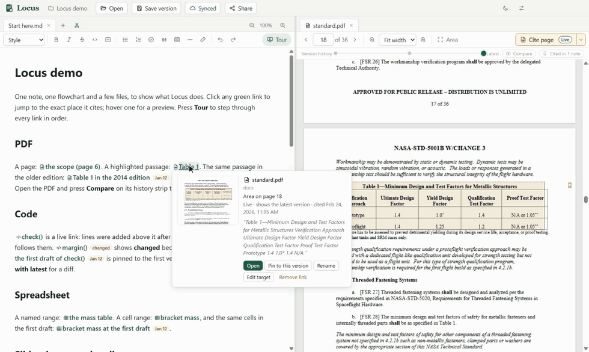
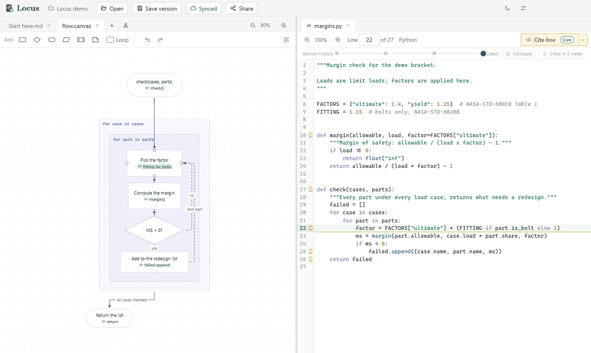
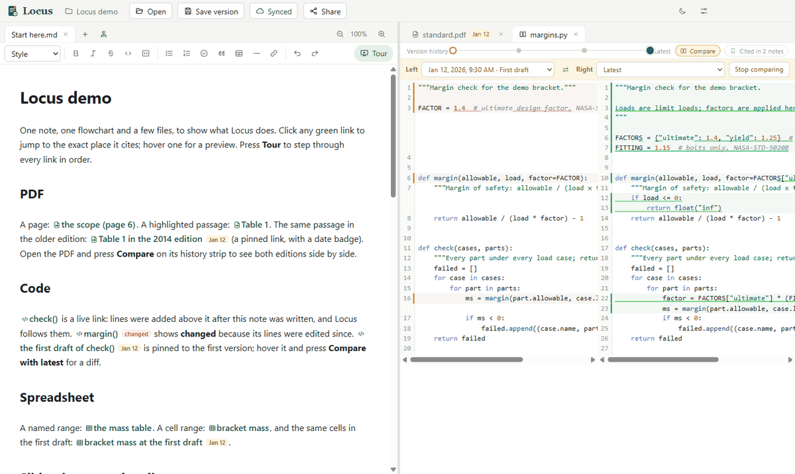

<h1 align="center">Locus</h1>

  <b>Notes that link to the exact spot.</b> 
  Write on the left. Read the source on the right. Every link lands right where it points.

  <a href="https://github.com/DanKrsi/locus/releases/latest"><b>Download for Windows</b></a>
  &nbsp;·&nbsp;
  <a href="#get-started">Get started</a>
  &nbsp;·&nbsp;
  <a href="docs/claude.md">Use with Claude</a>

  

## Click a link, land on the spot

Select something in a document, press **Cite**, and a link drops into your note. Click it any
time and you're back there, highlighted and centred:

| Link to | And land on |
|---|---|
| **PDFs** | the page, or the exact passage, boxed |
| **Code** | the lines, even after code above them moved |
| **Spreadsheets** | a cell range or a named range |
| **Slides, images, recordings** | the slide, the area, the second |
| **The past** | any earlier version of a file |

## Flowcharts that cite the code

Draw boxes, decisions and nested loops, route the arrows how you like, and put citations right
in the boxes. Click one and the code opens beside it.

## Links that keep up with change

Locus quietly keeps a version history of your folder, with no setup and no git knowledge
needed. Each link either **follows the latest version** (and flags when the part you cited has
changed) or **stays pinned** to the version you cited. Pick two versions and compare them side
by side.

## Claude writes the tour

Connect Claude Code or Claude Desktop in one click from **Settings → Claude**, then ask:

> *"Give me a tour of this codebase as a Locus note."*

Claude reads your folder and writes notes and flowcharts where every link is checked against
the real file: the right lines, the right page, the right version. [More about Claude](docs/claude.md)

## And also

- **Plain files.** Notes are markdown (`.md`) and flowcharts are JSON Canvas (`.canvas`), so
  they open in other apps too, Obsidian included. Nothing is locked in.
- **Share** a whole workspace, history and all, as one `.locus` file, or sync it through GitHub.
- **Tour mode** steps through every link in a note with the arrow keys.
- Light and dark themes.

## Get started

1. **Install.** From the [latest release](https://github.com/DanKrsi/locus/releases/latest),
   download `Locus-Setup-<version>.exe` and run it. It installs just for you, needs no admin
   rights, and includes everything it needs.
   > Windows may say "Windows protected your PC" because the installer isn't signed yet. Click
   > **More info**, then **Run anyway**.
2. **Try the demo.** It's a small workspace with one note and one flowchart linking into a PDF,
   code, a spreadsheet, slides, an image and a recording. Get it either way:
   - **No account needed:** from the same release, download `Locus-demo.locus` and double-click
     it. Locus unpacks it into a folder and opens it.
   - **With git:** `git clone https://github.com/DanKrsi/locus-sample.git`, then open that folder
     in Locus. (A zip download from GitHub won't work, because the demo needs its version history.)

   Then open **Start here** and click any green link, or press **Tour** to walk through them all.
3. **Use your own folder.** Click the workspace name at the top left (or **Open a folder** on the
   welcome screen) and pick any folder of documents. **Open** at the top opens files: notes and
   flowcharts on the left, everything else on the right.

Locus runs on Windows for now.

## Learn more

- [Locus and Claude](docs/claude.md): setup and the tools Claude gets
- [Link format](docs/spec/link-format.md) and [how the app works](docs/spec/ui.md)
- [Building from source](docs/development.md) · [Roadmap](docs/roadmap.md)

## License

[MIT](LICENSE)
