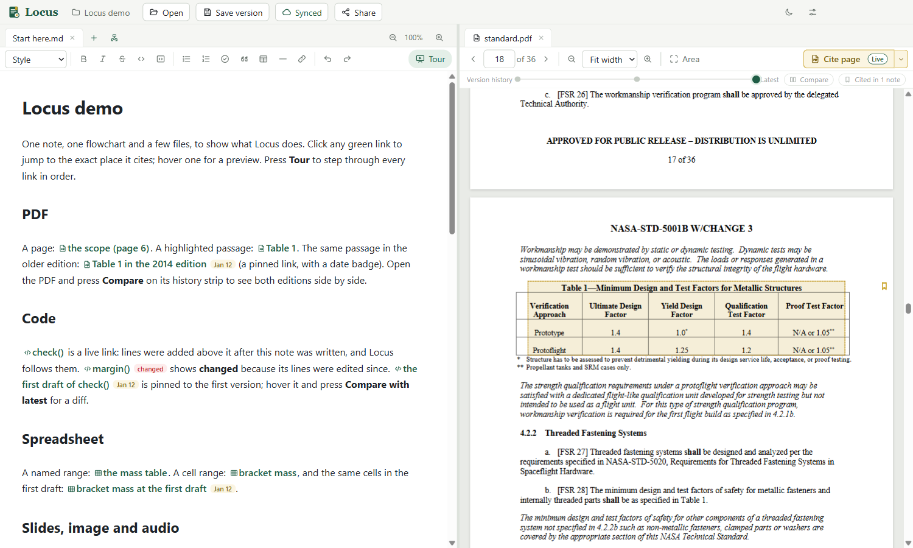

# Locus

**Notes that link to the exact spot.** Write on the left, read the source on the right, and
every link jumps straight to what it cites: a highlighted passage in a PDF, lines of code,
spreadsheet cells, a slide, a moment in a recording, even an older version of a file.

## What you can do

- **Cite anything precisely.** Select something in a document, press **Cite**, and a link lands
  in your note. Click it later and you're back at that exact spot, highlighted.
- **Keep links honest over time.** Locus keeps a version history of your folder for you. A link
  can follow the latest version (and warn you when the cited part changes) or stay pinned to
  the version you cited.
- **Draw flowcharts** with citations inside the boxes, for explaining code or a process.
- **Let Claude write the notes.** Claude can read your folder and write tours and flowcharts
  whose links are all checked. See [Locus and Claude](docs/claude.md).
- **Share** a workspace as one file, or sync it through GitHub.

Your notes stay plain markdown (`.md`) files, and the links are ordinary markdown links, so
nothing is locked in.

## Get started

1. **Install.** From the [latest release](https://github.com/DanKrsi/locus/releases/latest), download
   `Locus-Setup-<version>.exe` and run it. It installs just for you, needs no admin rights, and
   includes everything it needs.
   > Windows may say "Windows protected your PC" because the installer isn't signed yet. Click
   > **More info**, then **Run anyway**.
2. **Try the demo.** It's a small workspace with one note linking into a PDF, code, a
   spreadsheet, slides, an image and a recording. Get it either way:
   - **No account needed:** from the same release, download `Locus-demo.locus` and double-click
     it. Locus unpacks it into a folder and opens it.
   - **With git:** `git clone https://github.com/DanKrsi/locus-sample.git`, then open that folder
     in Locus. (A zip download from GitHub won't work, because the demo needs its version history.)

   Then open **Start here** and click any green link, or press **Tour** to walk through them all.
3. **Use your own folder.** Click the workspace name at the top left (or **Open a folder** on the
   welcome screen) and pick any folder of documents. **Open** at the top opens files: notes and flowcharts on the
   left, everything else on the right. Select something in a document and press **Cite**.

Locus runs on Windows for now.

## Learn more

- [Locus and Claude](docs/claude.md): connect Claude Code or Claude Desktop
- [Link format](docs/spec/link-format.md) and [how the app works](docs/spec/ui.md)
- [Building from source](docs/development.md)
- [Roadmap](docs/roadmap.md)

## License

[MIT](LICENSE)
